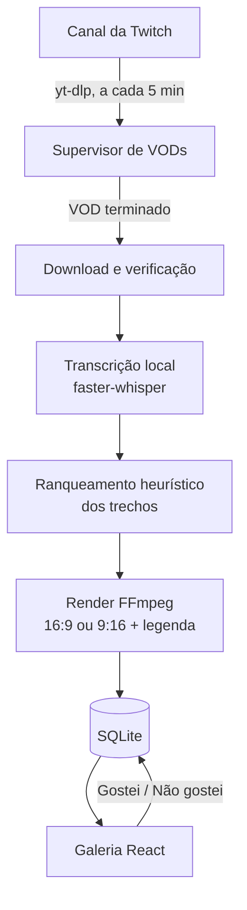

# AI Stream Editor

**Português** · [English](docs/README.en.md)

Automação local que acompanha um canal da Twitch, baixa os VODs públicos novos e gera cortes com legenda em português. O resultado aparece numa galeria, onde cada corte é assistido e marcado como **Gostei** ou **Não gostei**.

Tudo roda no computador do usuário: download, transcrição, seleção e renderização. Não há serviço pago, conta de nuvem nem envio de áudio para terceiros.

> **Estado:** protótipo funcional em desenvolvimento. A cadeia completa foi testada com mídia sintética e transcrição real offline. O download de um VOD real da Twitch e a qualidade editorial dos cortes ainda não foram validados (detalhes em [Limitações](#limitações)).

## Como funciona



1. **Descoberta.** Um supervisor consulta o canal a cada 300 s. Na primeira consulta considera só o VOD mais recente. Antes de baixar, confere que a duração ficou estável entre duas consultas e que o vídeo não está ao vivo.
2. **Download.** Cada tentativa usa um diretório novo, com limite de tamanho, reserva mínima de disco, timeout e até três tentativas com espera crescente. Um arquivo parcial nunca vira projeto.
3. **Transcrição.** O `faster-whisper` roda na CPU com pesos baixados uma única vez. Durante a análise, nenhum modelo é baixado.
4. **Seleção.** Regras sobre a transcrição sugerem trechos. É uma heurística explícita, não compreensão semântica nem previsão de viralização.
5. **Render.** O FFmpeg gera o MP4 com legenda queimada. No formato 9:16, um detector local tenta posicionar a câmera acima do conteúdo; sem detecção confiável, preserva o quadro inteiro e registra um aviso.
6. **Avaliação.** A galeria pagina os cortes e grava a avaliação. Avaliar não regenera o vídeo nem treina o modelo.

## Tecnologias

| Camada | Uso |
| --- | --- |
| Python 3.12, FastAPI, Uvicorn | API local em `127.0.0.1:8765` e supervisor da automação |
| faster-whisper | Transcrição offline em CPU |
| yt-dlp (versão fixada) | Listagem e download de VODs públicos |
| FFmpeg / FFprobe | Corte, legenda, conversão de formato e verificação dos arquivos |
| OpenCV | Localização de rosto para o layout vertical, sem identificar pessoas |
| SQLite | Projetos, trabalhos, cortes e avaliações |
| React 19, TypeScript, Vite | Galeria e painel de estado da automação |
| Vitest, Testing Library, pytest | Testes do frontend e do backend |

## Estrutura

```
backend/
  ai_stream_editor/
    api.py          rotas HTTP (automação, galeria, projetos, cortes)
    automation.py   supervisor persistente de VODs
    twitch.py       descoberta e download via yt-dlp
    analysis.py     transcrição e ranqueamento heurístico
    media.py        operações FFmpeg; o arquivo original nunca é alterado
    camera.py       detecção local de rosto para o layout 9:16
    service.py      fila de trabalhos, cancelamento e recuperação
    store.py        persistência SQLite
    diagnostics.py  verificações somente leitura do ambiente
  tests/            pytest: unidade, API, ciclo de vida e mídia
frontend/
  src/              galeria, painel de automação e cliente da API
  launcher/         lançador Windows opcional (C#)
docs/
  decisions/        registros de decisão (ADRs)
  implementation/   validações, medições e limites de cada etapa
  coordination/     contrato HTTP e estado da integração
scripts/            preparação, inicialização e diagnóstico no Windows
```

## Executar

**Requisitos:** Python 3.12, Node.js 24 e FFmpeg/FFprobe no `PATH`, com `libx264` e `libass`. Não precisa de GPU.

### Windows (scripts do projeto)

```powershell
.\scripts\setup-backend.ps1                 # cria backend/.venv com o requirements.lock
.\scripts\start-backend.ps1 -PrepareModel   # baixa os pesos públicos do modelo "base" e inicia a API
```

Em outro terminal:

```powershell
cd frontend
npm ci
npm run dev
```

Abra http://127.0.0.1:5173. Depois da primeira preparação, `.\scripts\start-local.ps1` inicia a API e a interface juntas. Ele reaproveita serviços que já estejam rodando e não encerra processos que não iniciou.

### Qualquer sistema (comandos diretos)

```bash
cd backend
python -m venv .venv
.venv/bin/pip install -e ".[test]"                 # Windows: .venv\Scripts\pip
.venv/bin/python -m ai_stream_editor prepare-model  # pesos públicos, nenhum áudio é enviado
.venv/bin/python -m ai_stream_editor doctor --no-api
.venv/bin/python -m ai_stream_editor serve
```

A documentação interativa da API fica em http://127.0.0.1:8765/docs. Para ver a interface sem backend, use `npm run dev:mock`.

### Configuração

| Variável | Padrão |
| --- | --- |
| `AI_STREAM_DATA_DIR` | `%LOCALAPPDATA%/AIStreamEditor` (banco, transcrições, cortes e modelos) |
| `AI_STREAM_MODEL_DIR` | `<data_dir>/models` |
| `AI_STREAM_MODEL` | `base` (`tiny` e `small` também funcionam) |
| `AI_STREAM_FFMPEG` / `AI_STREAM_FFPROBE` | `ffmpeg` / `ffprobe` |

O canal e o formato de saída são configurados pela interface ou por `PATCH /api/automation`.

## Testes

```bash
cd backend && .venv/bin/python -m pytest -q
cd frontend && npm test && npm run typecheck && npm run lint && npm run build
```

Resultado em um clone limpo, em 10/11/2026 (Windows 11, Python 3.12.10, Node 24.19):

- Backend: **165 testes e 21 subtestes aprovados**.
- Frontend: **44 testes aprovados**; typecheck, lint e build sem erros.
- `prepare-model` (modelo `tiny`), `doctor --no-api` e `serve` executados: diagnóstico `ready: true`, `/api/health` com modelo pronto e uma consulta real ao canal concluída.

Os testes de mídia usam vídeos sintéticos gerados com FFmpeg. Existem também benchmarks e verificações de inicialização e encerramento em `backend/tests/` (`benchmark_*.py`, `smoke_*.py`), executados à parte.

## Limitações

- **Download real não validado.** O canal configurado retornou zero VODs na consulta real (repetida em 10/11/2026 com o mesmo resultado; a consulta em si funcionou). A automação foi testada com uma fonte sintética controlada, transcrição real e FFmpeg real.
- **Qualidade editorial não avaliada.** A seleção é heurística e ainda não foi comparada com a escolha humana em uma live representativa.
- **Depende do computador ligado.** Sem a API rodando, nada é buscado. Após um período longo offline, a janela de 50 vídeos recentes pode deixar conteúdo antigo de fora.
- **Integração não oficial.** O yt-dlp não é uma API oficial da Twitch e pode quebrar com mudanças da plataforma. Conteúdo restrito falha com uma mensagem, sem tentativa de contorno.
- **Sem limpeza automática.** Downloads e cortes antigos permanecem em disco até serem removidos manualmente.

## Como o projeto foi desenvolvido

Conduzi o projeto usando Claude Code e Codex como agentes de desenvolvimento, com divisão explícita entre backend e frontend. Cada etapa tem decisão registrada, critério de aceite e evidência de teste. Esse histórico está em [`docs/decisions/`](docs/decisions/README.md), [`docs/implementation/`](docs/implementation/) e [`docs/coordination/`](docs/coordination/integration-contract.md). O README anterior, com o histórico do MVP de edição manual, está em [`docs/history/`](docs/history/readme-2026-10-30.md).

A pasta `.agents/skills/remotion-best-practices/` contém referências de terceiros usadas pelos agentes. Ela não faz parte da aplicação.
