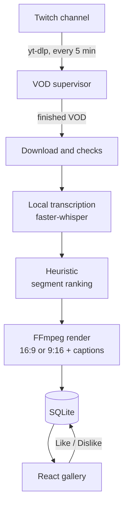

# AI Stream Editor

[Português](../README.md) · **English**

Local automation that watches a Twitch channel, downloads new public VODs and turns them into clips with Portuguese captions. The clips show up in a gallery where each one is watched and rated **Like** or **Dislike**.

Everything runs on the user's computer: download, transcription, selection and rendering. No paid service, cloud account or third-party audio upload is involved.

> **Status:** working prototype in development. The full chain was tested with synthetic media and real offline transcription. Downloading a real Twitch VOD and the editorial quality of the clips have not been validated yet (see [Limitations](#limitations)).

## How it works



1. **Discovery.** A supervisor polls the channel every 300 s. On the first poll it only considers the most recent VOD. Before downloading, it checks that the duration is stable across two polls and that the video is not live.
2. **Download.** Each attempt uses a fresh directory, with a size cap, a minimum free-space reserve, timeouts and up to three retries with growing backoff. A partial file never becomes a project.
3. **Transcription.** `faster-whisper` runs on the CPU with weights downloaded once. No model is downloaded during analysis.
4. **Selection.** Rules over the transcript suggest segments. This is an explicit heuristic, not semantic understanding or virality prediction.
5. **Render.** FFmpeg produces an MP4 with burned-in captions. For 9:16, a local detector tries to place the webcam above the content; without a reliable detection it keeps the full frame and records a warning.
6. **Review.** The gallery pages through the clips and stores ratings. Rating a clip neither re-renders it nor trains anything.

## Stack

| Layer | Used for |
| --- | --- |
| Python 3.12, FastAPI, Uvicorn | Local API on `127.0.0.1:8765` and the automation supervisor |
| faster-whisper | Offline CPU transcription |
| yt-dlp (pinned) | Listing and downloading public VODs |
| FFmpeg / FFprobe | Trimming, captions, format conversion and file checks |
| OpenCV | Face location for the vertical layout, without identifying anyone |
| SQLite | Projects, jobs, clips and ratings |
| React 19, TypeScript, Vite | Gallery and automation status panel |
| Vitest, Testing Library, pytest | Frontend and backend tests |

## Running it

**Requirements:** Python 3.12, Node.js 24 and FFmpeg/FFprobe on `PATH` with `libx264` and `libass`. No GPU needed.

```bash
cd backend
python -m venv .venv
.venv/bin/pip install -e ".[test]"                 # Windows: .venv\Scripts\pip
.venv/bin/python -m ai_stream_editor prepare-model  # public weights only; no audio is sent
.venv/bin/python -m ai_stream_editor serve          # API docs at http://127.0.0.1:8765/docs
```

In another terminal:

```bash
cd frontend
npm ci
npm run dev        # http://127.0.0.1:5173 ; npm run dev:mock works without the backend
```

On Windows, `scripts/setup-backend.ps1`, `scripts/start-backend.ps1 -PrepareModel` and `scripts/start-local.ps1` wrap the same steps. Data lives in `%LOCALAPPDATA%/AIStreamEditor` by default (`AI_STREAM_DATA_DIR` overrides it).

## Tests

Results from a clean clone on 10 Nov 2026 (Windows 11, Python 3.12.10, Node 24.19):

- Backend: **165 tests and 21 subtests passed**.
- Frontend: **44 tests passed**; typecheck, lint and build clean.

Media tests use synthetic videos generated with FFmpeg. Benchmarks and startup/shutdown checks live in `backend/tests/` (`benchmark_*.py`, `smoke_*.py`) and run separately.

## Limitations

- **Real download not validated.** The configured channel returned zero VODs when queried (checked again on 10 Nov 2026 with the same result; the query itself worked). Automation was tested with a controlled synthetic source, real transcription and real FFmpeg.
- **Editorial quality not evaluated.** Selection is heuristic and has not been compared with human picks on a representative stream.
- **Needs the computer on.** Nothing is fetched while the API is down. After a long offline period, the 50-item window may miss older VODs.
- **Unofficial integration.** yt-dlp is not an official Twitch API and can break when the platform changes. Restricted content fails with a message; there is no workaround attempt.
- **No automatic cleanup.** Downloads and old clips stay on disk until removed manually.

## How it was built

I ran this project with Claude Code and Codex as development agents, with an explicit backend/frontend split. Every stage has a recorded decision, acceptance criteria and test evidence, kept in [`decisions/`](decisions/README.md), [`implementation/`](implementation/) and [`coordination/`](coordination/integration-contract.md) (Portuguese).

The `.agents/skills/remotion-best-practices/` folder holds third-party reference material used by the agents. It is not part of the application.
